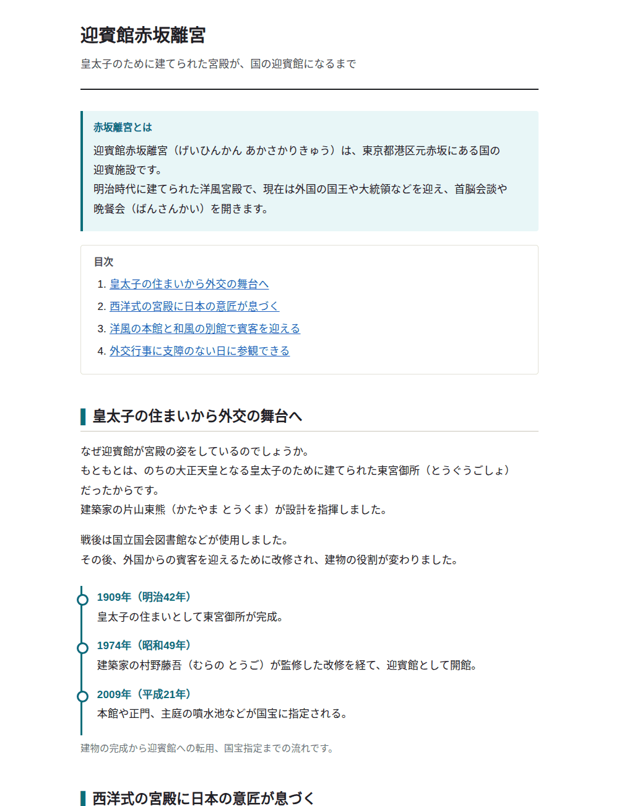
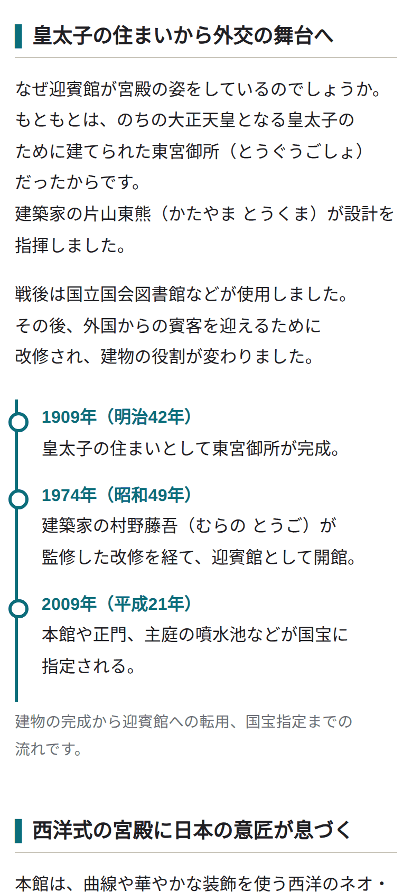

# yp-explainer-html

調べたことや手順を、専門知識のない人でも読める HTML ファイル1枚の資料にするスキルです。
Agent Skills の形式で書いてあり、ChatGPT の Codex や Claude Code で使えます。

<p>


</p>

上の画面は、このスキルだけを入れた AI に「赤坂離宮に関する資料を作って」とだけ頼んで出来た資料です。
ほかの指示や設定は何も渡していません。
資料そのものは [`examples/akasaka-palace.html`](examples/akasaka-palace.html) にあり、ダウンロードしてブラウザで開くと見られます。

## できること

- 結論・目次・本文・出典の順に並んだ、白を基調にした資料を作ります
- 比較は表、手順は番号付きの一覧、年代や場所や仕組みは図にします
- インターネットにつながなくても開けます。Python や Node などの追加のソフトは要りません
- 書体はパソコンに入っている日本語の書体を使います。中国語や英語の Windows でも、日本語の書体が入っていれば漢字が日本語の字形で出ます
- 印刷しても、表・図・枠がページの途中で切れにくいようにしてあります

## 中身

| ファイル | 役割 |
|---|---|
| `yp-explainer-html/SKILL.md` | AI が読む手順書。書き方・図の使い方・渡す前の確認 |
| `yp-explainer-html/assets/template.html` | 資料のひな形。見た目（CSS）と、囲み・表・年表などの HTML の書き方が入っている |
| `examples/` | 見本の資料と、その画面の写真。スキルを使うときには要らない |

## 入れ方

使っている AI に次の文を送ると、その時点の公式の方法で入れてくれます。
スキルの置き場所はアプリによって違い、あとから変わることもあるためです。

```text
github.com/YoyogiPinball/yp-explainer-html の yp-explainer-html フォルダーを、公式の導入方法を調べて、どのフォルダーで作業していても使えるスキルとして入れてください。
入れ終わったら、新しいチャットで短い資料を1つ作って確かめてください。
```

- ChatGPT（Codex）のスキルの公式の説明: https://learn.chatgpt.com/docs/build-skills

## 使い方

「〇〇について資料にまとめて」「この手順を HTML の資料にして」のように頼みます。
保存する場所を言わなければ、いま開いているフォルダーに保存されます。
文章を整える yomiyasu（https://github.com/nanaism/yomiyasu ）も入れておくと、仕上げに使われます。

## 見本について

見本の資料は AI が作ったままのものです。
年・建築家・国宝の指定・和風別館の設計者は、[内閣府の迎賓館赤坂離宮のページ](https://www.geihinkan.go.jp/akasaka/about/)と照らしてあります。
参観の日程や料金など、そのほかの内容は公式の案内で確かめてください。

## ライセンス

MIT License です。詳しくは `LICENSE` を見てください。
